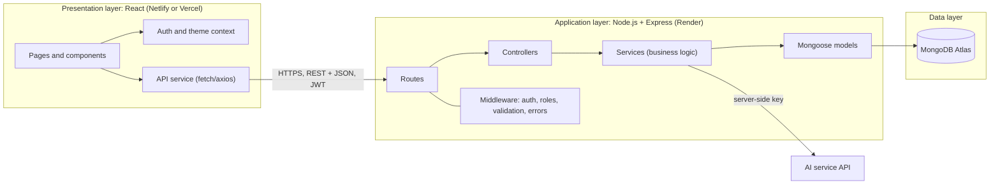
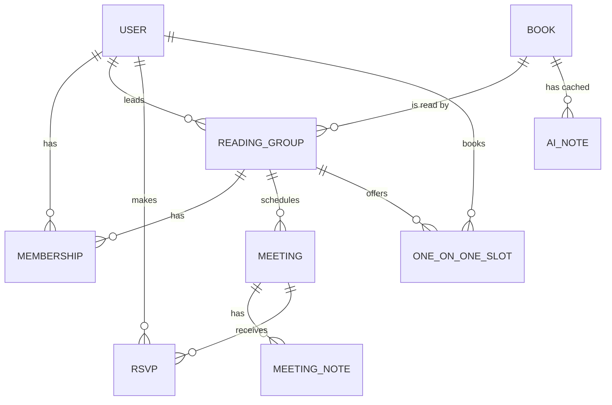

# A Novel Idea: Design

Covers the architecture overview, database design, API plan, AI feature design, and page and component plan. Wireframes for the website (light and dark) and the phone app are produced separately and will be exported into `docs/wireframes/` and the final documentation file.

---

## 1. Architecture overview

A Novel Idea uses a **3-tier architecture**.



**Responsibilities**
- **Presentation (React):** renders pages, handles forms and client-side validation, stores the login token, and calls the API. It never talks to the database or the AI service directly.
- **Application (Express):** the only layer that touches data. Routes map URLs to controllers, controllers handle the request and response, **services hold the business rules** (capacity, one membership per group, one-on-one allowance, spoiler limits), and models define the data. It also calls the AI service so the API key stays secret.
- **Data (MongoDB with Mongoose):** stores users, books, groups, memberships, meetings, notes, one-on-ones, and cached AI output.

**Request flow example (join a group):** React `TimeSlotPicker` → `POST /api/groups/:id/join` with a token → `protect` middleware checks the token → controller validates input → `bookingService.joinGroup` checks capacity and duplicates → `Membership` is saved → JSON response → React updates the page.

### 1.1 Planned folder structure

```
a-novel-idea/
├── README.md
├── docs/                      planning, requirements, design, wireframes
├── server/
│   └── src/
│       ├── config/            database connection
│       ├── models/            Mongoose schemas
│       ├── routes/            URL to controller mapping
│       ├── controllers/       request and response handling
│       ├── services/          business logic (booking, meetings, AI, links)
│       ├── middleware/        auth, validation, error handling
│       ├── utils/             helpers (AppError, asyncHandler, token)
│       ├── app.js             Express app
│       └── server.js          entry point
└── client/
    └── src/
        ├── components/        reusable UI pieces
        ├── pages/             one file per screen
        ├── context/           AuthContext, ThemeContext
        ├── services/          API calls
        ├── hooks/             custom hooks
        ├── styles/            theme variables and global CSS
        └── utils/             date, time zone, formatting helpers
```

### 1.2 Technology choices

| Concern | Choice | Reason |
|---|---|---|
| Frontend | React (built with Vite), React Router, Context API | Required stack; routing and shared state with little boilerplate |
| Backend | Node.js, Express 4 | Required stack; large ecosystem |
| Database | MongoDB Atlas free tier with Mongoose | Required stack; schemas and validation; one service for development and production |
| Authentication | bcrypt password hashing, JWT sent as a Bearer token | Simple, stateless, standard |
| Validation | express-validator on the server, form checks on the client | Defense in depth |
| AI | Anthropic Claude API called from the server | Key stays private; model name set by an environment variable |
| Hosting | Netlify or Vercel (frontend), Render (backend), Atlas (database) | Free tiers and the recommended platforms |

---

## 2. Database design (MongoDB and Mongoose)

### 2.1 Entity relationship diagram



### 2.2 Collections

**users** (built in Stage 1)

| Field | Type | Notes |
|---|---|---|
| name | String | required, max 60 |
| email | String | required, unique, lowercase |
| password | String | bcrypt hash, excluded from queries by default |
| role | String | `member` (default), `leader`, `admin` |
| timezone | String | IANA name, e.g. `America/Denver` |
| themePreference | String | `light` or `dark` |
| createdAt, updatedAt | Date | automatic |

**books**

| Field | Type | Notes |
|---|---|---|
| title, author | String | required |
| genre | String | category used for filtering; indexed |
| description | String | shown on the detail page |
| coverUrl | String | image link |
| accentColors | Object | tile and title colors taken from the cover |
| pageCount | Number | optional |

**readingGroups** (the bookable "service")

| Field | Type | Notes |
|---|---|---|
| book | ObjectId → books | required |
| leader | ObjectId → users | required |
| sessionMinutes | Number | session duration, default 60 |
| timeSlots | Array of 2 sub-documents | each: `dayOfWeek` (0 to 6), `startTime` ("19:00"), `timezone` (IANA), `capacity`, `meetingLink` |
| startDate | Date | first week of the read |
| totalWeeks | Number | length of the read |
| currentWeek | Number | used to limit spoilers in AI output |
| oneOnOneAllowance | Number | per member, default 2 |
| status | String | `open`, `in-progress`, `finished` |

Validation: `timeSlots` must contain exactly two entries and the two must differ.

**memberships** (the booking)

| Field | Type | Notes |
|---|---|---|
| user | ObjectId → users | required |
| group | ObjectId → readingGroups | required |
| slotId | ObjectId | the `_id` of the chosen entry in the group's `timeSlots` |
| status | String | `active` or `cancelled` |
| joinedAt, cancelledAt | Date | |

Unique partial index on `{ user, group }` where `status = "active"` so a user cannot hold two active memberships in one group. Seats left for a time option = capacity minus the count of active memberships with that `slotId`.

**meetings** (generated weekly per time option)

| Field | Type | Notes |
|---|---|---|
| group | ObjectId → readingGroups | |
| slotId | ObjectId | which time option |
| weekNumber | Number | |
| startsAtUtc | Date | always UTC |
| durationMinutes | Number | |
| meetingLink | String | |
| chapters | String | e.g. "Ch. 1 to 2" |
| status | String | `scheduled`, `held`, `cancelled` |

**meetingNotes**

| Field | Type | Notes |
|---|---|---|
| meeting | ObjectId → meetings | |
| author | ObjectId → users | the leader |
| content | String | what was discussed |
| publishedAt | Date | |

**rsvps**: `meeting`, `user`, `response` (`attending` or `cannot_attend`); unique on `{ meeting, user }`.

**oneOnOneSlots**

| Field | Type | Notes |
|---|---|---|
| group, leader | ObjectId | |
| startsAtUtc | Date | |
| durationMinutes | Number | |
| meetingLink | String | |
| bookedBy | ObjectId → users, optional | empty while open |
| status | String | `open`, `booked`, `completed`, `cancelled` |

A member's allowance used = their slots in the group with status `booked` or `completed`. A slot can be booked by only one member.

**aiNotes** (cache): `book`, `type` (`study-notes`, `insights`, `review-summary`), `upToWeek`, `content`, `generatedAt`. Unique on `{ book, type, upToWeek }`.

**ads** (optional): `title`, `sponsorName`, `imageUrl`, `linkUrl`, `active`.

### 2.3 Design decisions
- **Time options live inside the group** as a two-item array because they never exist without the group and are always read with it.
- **Memberships are a separate collection** because they are queried from both sides (a user's bookings, a group's members) and need their own unique rule.
- **Times are stored in UTC** in meetings and one-on-one slots. The group's weekly pattern keeps its IANA time zone so daylight saving time is handled correctly when meetings are generated.
- **Allowance and seats are calculated** from records instead of stored as counters, so they cannot drift out of sync.

---

## 3. API plan (REST)

All routes begin with `/api`. Responses use `{ success, ... }`; errors use `{ success: false, message }`.

| Area | Method and path | Access | Purpose |
|---|---|---|---|
| Auth | POST `/auth/register`, `/auth/login` | Public | Create account, log in *(done)* |
| Auth | GET `/auth/me`, POST `/auth/logout` | Member | Current user, log out *(done)* |
| Profile | PUT `/users/me` | Member | Update time zone and theme |
| Books | GET `/books?genre=&q=&page=` | Public | Browse and search |
| Books | GET `/books/:id` | Public | Book details |
| Books | POST, PUT, DELETE `/books`, `/books/:id` | Admin | Manage books |
| Groups | GET `/groups?genre=&day=` | Public | List groups with seats left per time |
| Groups | GET `/groups/:id` | Public | Group details |
| Groups | POST, PUT `/groups`, `/groups/:id` | Leader, admin | Create and edit groups |
| Booking | POST `/groups/:id/join` | Member | Join with `{ slotId }` |
| Booking | PUT `/memberships/:id` | Member | Switch time with `{ slotId }` |
| Booking | DELETE `/memberships/:id` | Member | Leave a group |
| Booking | GET `/me/memberships` | Member | My bookings |
| Meetings | GET `/me/meetings` | Member | Upcoming meetings |
| Meetings | POST `/meetings/:id/rsvp` | Member | Attending or cannot attend |
| Notes | GET `/groups/:id/notes` | Group member | Weekly notes |
| Notes | POST, PUT, DELETE `/meetings/:id/notes` | Group leader | Manage notes |
| One-on-ones | GET `/groups/:id/one-on-ones` | Group member | Open slots |
| One-on-ones | POST `/groups/:id/one-on-ones` | Group leader | Publish slots |
| One-on-ones | POST `/one-on-ones/:id/book`, DELETE `/one-on-ones/:id/book` | Member | Book and cancel |
| AI | POST `/ai/assistant` | Member | Chat with the reading assistant |
| AI | GET `/ai/books/:id/study-notes?week=` | Group member | Study notes up to a week |
| AI | GET `/books/:id/links` | Public | Review, bookstore, library, and ebook links |

---

## 4. AI feature design

**Feature:** the **Book Assistant**. On the home page it appears as a pop-up window; on every other page it is an **Ask AI** button. It is part of the main workflow: a member describes what they like, receives recommendations, and joins a group from the answer.

**Capabilities**
1. **Find my next book:** recommendations based on the member's mood, genres, and schedule.
2. **Review links and where to buy:** links to reviews, bookstore searches, library catalogs, and ebook options.
3. **Study notes and insights:** summaries, themes, and discussion questions for a book, limited to the group's current week.

**How it works**
1. The React chat component sends the member's message to `POST /api/ai/assistant`.
2. The server loads a short list of real books and open groups from MongoDB (id, title, author, genre, short description, time options, seats left).
3. The server sends that list and the question to the AI API with a system prompt. The prompt tells the AI to recommend only books from the list, to return structured JSON (`reply` plus `recommendations` with book and group ids), and to avoid spoilers.
4. The server checks that every recommended id exists, then returns the reply. React renders the answer with a **View book** and **Join** button for each recommendation.
5. Study notes are cached in `aiNotes` so the same request does not call the AI again.

**Safeguards**
- The API key and model name live in environment variables on the server only.
- Purchase and review links are built by application code from the book's title and author; the AI never supplies prices, stock, or URLs.
- Only minimal data is sent (no emails, names, or passwords).
- Per-user rate limiting protects cost.
- If the AI call fails, the app shows a friendly message and every other feature keeps working.
- All AI content is labeled "AI-generated" and may contain errors.

---

## 5. Page and component plan

### 5.1 Pages and routes

| Route | Page | Access | Notes |
|---|---|---|---|
| `/` | Browse ("The journey") | Public | Genre carousels, search and filters, AI pop-up |
| `/books/:id` | Book detail ("The adventure") | Public | Centered cover and title, two-time picker, join, reading help, schedule and weekly notes |
| `/login`, `/register` | Authentication | Public | Forms with validation |
| `/dashboard` | My meetings | Member | My groups, next meeting, upcoming list, weekly notes, one-on-ones |
| `/leader` | Leader tools | Leader | Create groups, set times and links, publish notes and slots |
| `/admin` | Admin | Admin | Books, users, ads (if time allows) |
| `*` | Not found | Public | Friendly 404 |

### 5.2 Components

| Component | Purpose |
|---|---|
| `Navbar`, `Logo`, `ThemeToggle` | Navigation, quill-and-vine logo, light and dark switch |
| `BookCarousel`, `BookTile` | Genre rows with a larger centered book and side arrows |
| `SearchFilters` | Search box and genre and day filters |
| `TimeSlotPicker` | Choose one of two meeting times with seats left |
| `GroupInfoStrip` | Meets, where, leader, members |
| `JoinPanel` | Join, switch time, leave |
| `ReadingHelpPanel` | AI study notes, reviews, where to buy |
| `AiAssistant`, `AiAskButton` | Pop-up on the home page, button elsewhere |
| `ScheduleAndNotes`, `NotesViewer` | Weekly schedule with view-notes buttons |
| `MeetingCard`, `OneOnOneCard` | Dashboard items with video links |
| `ProtectedRoute` | Redirects unauthenticated users to login |
| `Loader`, `ErrorMessage`, `EmptyState`, `Toast` | Loading, error, and empty states |

### 5.3 State management
- **AuthContext:** current user and token, plus login, logout, and register actions
- **ThemeContext:** light or dark, saved to the user's profile and local storage
- Page data is fetched in each page through the API service and held in local state

### 5.4 Design system (from the wireframes)
- **Look:** aged parchment paper in the light theme, dark worn paper in the dark theme; book-inspired headings and chapter captions
- **Color:** teal and soft blue with a neutral brass accent; borders grey-black or tan in light and white in dark; per-book tile colors taken from the cover
- **AI box:** tan with blue functions in the light theme, navy with white border in the dark theme
- **Layout:** the book page centers the cover and title; the browse page uses carousels with side arrows; the phone app uses a bottom tab bar
